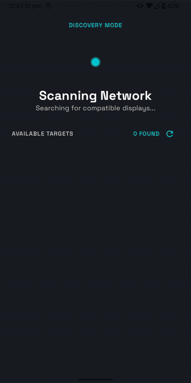
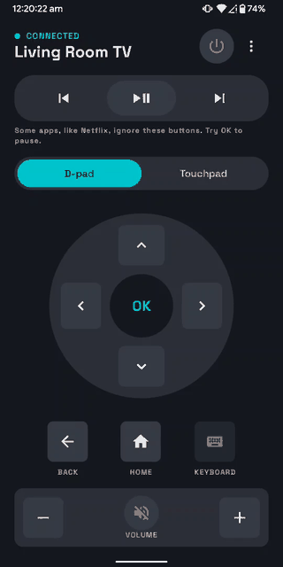
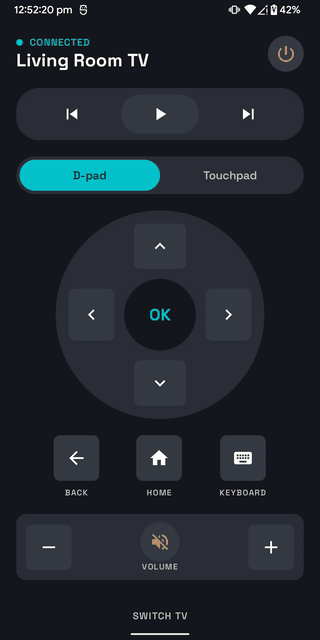
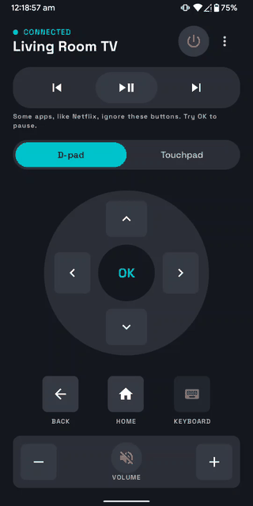

<div align="center">

# 📺 Air Mouse TV Remote

**Turn your phone into a remote for any Android TV / Google TV: no pairing hardware, no cloud, just your Wi-Fi.**


[**⬇️ Download the APK**](https://github.com/PrasoonDhaneshwar/AirMouseTVRemote/releases/download/1.2/AirMouseTVRemote-v1.2.apk)

</div>

---

## ✨ What it does

- **Finds your TV automatically.** mDNS discovery, with an HTTP name lookup for TVs that don't advertise one, and the last TV remembered so the app reconnects on launch.
- **Pairs like the official app.** Enter the 6-character code shown on the TV once (digits and capital letters on one keyboard), and you're paired. The app remembers the TV's certificate and refuses a different device answering at the same address.
- **Full remote on one screen.** D-pad or touchpad, OK, Back, Home, volume, mute, power and media controls, with no scrolling. Hold a key for a long press.
- **Type on the TV.** When a TV search box asks for text, the phone keyboard opens and types straight into it, and the box on the phone follows what the TV really holds.
- **YouTube search.** YouTube's own keyboard can't be typed into from a phone, so a button opens the results for your search on the TV.
- **Honest connection state.** The UI reflects whether the TV is really reachable, and reconnects when the network comes back.
- **Accessible and small.** The keys work with TalkBack, and the release APK is about 1.5 MB.

## 🎬 See it in action

| Find & pair | Navigate | Type on the TV | Switch TV |
|:---:|:---:|:---:|:---:|
|  |  |  |  |

## 👇 Get started

1. Put your phone and TV on the **same Wi-Fi network**.
2. [Download the APK](https://github.com/PrasoonDhaneshwar/AirMouseTVRemote/releases/download/1.2/AirMouseTVRemote-v1.2.apk) and install it.
3. Open the app and pick your TV from the list.
4. Type the code shown on the TV screen and tap **Connect Device**.
5. Start navigating.

**Build from source:** open the project in Android Studio (Narwhal or newer) and run the `app` configuration, or:

```bash
./gradlew assembleDebug
```

Run the unit tests with `./gradlew :app:testDebugUnitTest`. The release build is shrunk with R8 (`./gradlew assembleRelease`); the project needs JDK 17.

## 🛠️ Built with

- [Kotlin](https://kotlinlang.org/) and [Coroutines / Flow](https://kotlinlang.org/docs/coroutines-overview.html)
- [Jetpack Compose](https://developer.android.com/jetpack/compose) with [Material 3](https://m3.material.io/) (custom "Deep Code" theme)
- [Hilt](https://dagger.dev/hilt/) for dependency injection
- [Protocol Buffers (lite)](https://protobuf.dev/) for the Polo and remote protocols
- [BouncyCastle](https://www.bouncycastle.org/) for client certificate generation
- Android [NSD](https://developer.android.com/develop/connectivity/wifi/use-nsd) for mDNS discovery
- MVVM with a repository layer and unidirectional state
- JUnit and kotlinx-coroutines-test for the protocol, text-editing and connection logic

## 🔒 Privacy

Everything stays on your local network. There's no account, no analytics, no cloud service, and the app only talks to the TV you choose. Release builds drop the debug and info logging.

## 📄 License

Add a license of your choice (e.g. MIT) as `LICENSE` and mention it here.

---

<div align="center">
Made with ❤️ by <a href="https://github.com/PrasoonDhaneshwar">Prasoon Dhaneshwar</a>
</div>
