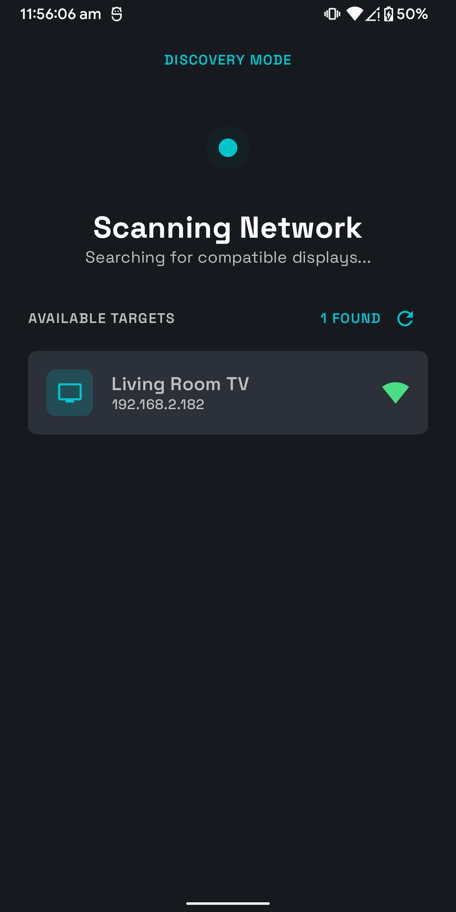
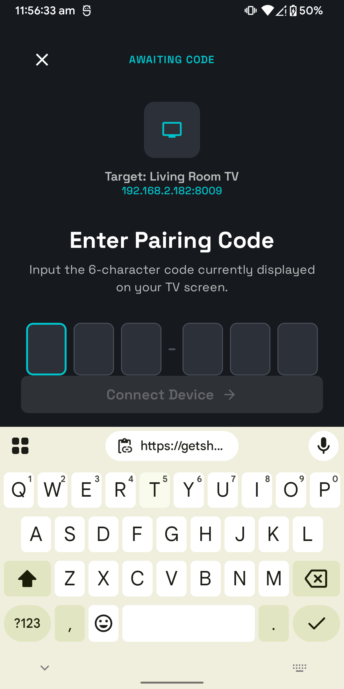
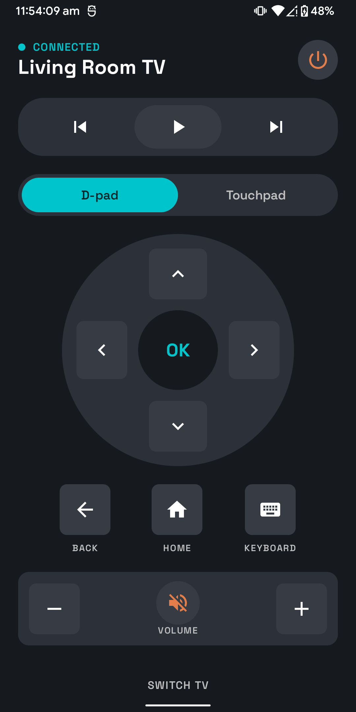
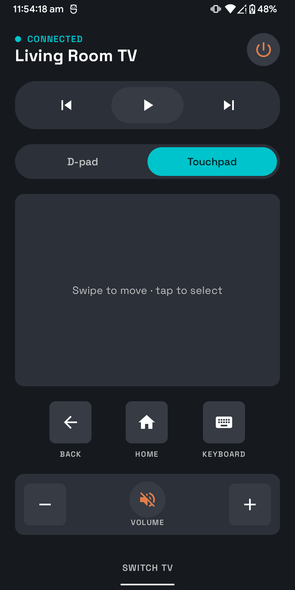
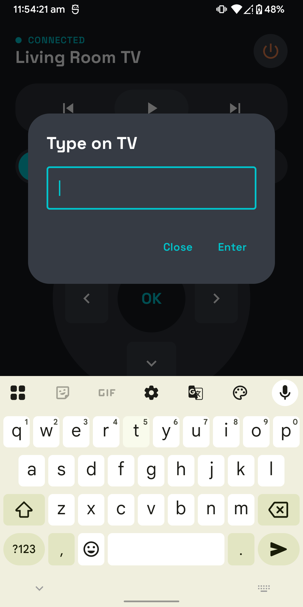

<div align="center">

# 📺 Air Mouse TV Remote

**Turn your phone into a remote for any Android TV / Google TV: no pairing hardware, no cloud, just your Wi-Fi.**


[**⬇️ Download the APK**](https://github.com/PrasoonDhaneshwar/AirMouseTVRemote/releases/latest)

</div>

---

## ✨ What it does

- **Finds your TV automatically.** mDNS discovery plus a port-scan fallback, with the last TV remembered so the app reconnects on launch.
- **Pairs like the official app.** Enter the 6-digit code shown on the TV once, and you're paired.
- **Full remote.** D-pad, OK, Back, Home, volume, mute, power and media controls.
- **Type on the TV.** When a TV search box asks for text, the phone keyboard opens and types straight into it.
- **Honest connection state.** The UI reflects whether the TV is really reachable, and reconnects when the network comes back.

## 📸 Screenshots

<div>
  
  
  
  
  
</div>

## 👇 Get started

1. Put your phone and TV on the **same Wi-Fi network**.
2. [Download the APK](https://github.com/PrasoonDhaneshwar/AirMouseTVRemote/releases/latest) and install it.
3. Open the app and pick your TV from the list.
4. Type the code shown on the TV screen.
5. Start navigating.

**Build from source:** open the project in Android Studio (Narwhal or newer) and run the `app` configuration, or:

```bash
./gradlew assembleDebug
```

## 🛠️ Built with

- [Kotlin](https://kotlinlang.org/) and [Coroutines / Flow](https://kotlinlang.org/docs/coroutines-overview.html)
- [Jetpack Compose](https://developer.android.com/jetpack/compose) with [Material 3](https://m3.material.io/) (custom "Deep Code" theme)
- [Hilt](https://dagger.dev/hilt/) for dependency injection
- [Protocol Buffers (lite)](https://protobuf.dev/) for the Polo and remote protocols
- [BouncyCastle](https://www.bouncycastle.org/) for client certificate generation
- Android [NSD](https://developer.android.com/develop/connectivity/wifi/use-nsd) for mDNS discovery
- MVVM with a repository layer and unidirectional state

## 🔒 Privacy

Everything stays on your local network. There's no account, no analytics, no cloud service, and the app only talks to the TV you choose.

## 📄 License

Add a license of your choice (e.g. MIT) as `LICENSE` and mention it here.

---

<div align="center">
Made with ❤️ by <a href="https://github.com/PrasoonDhaneshwar">Prasoon Dhaneshwar</a>
</div>
