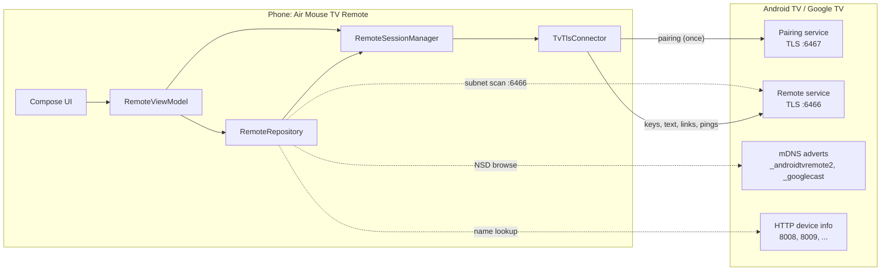
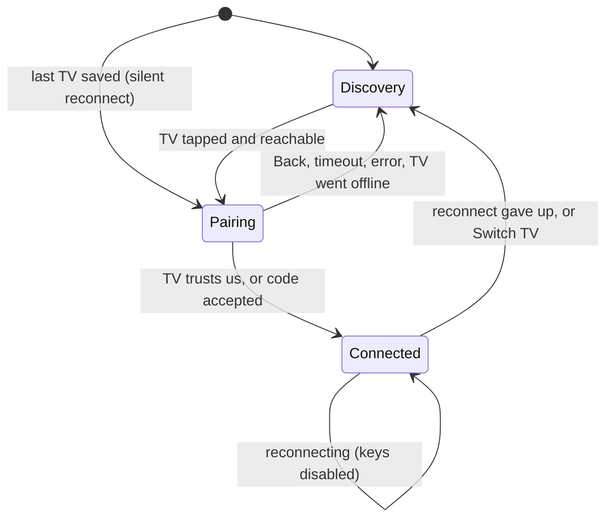
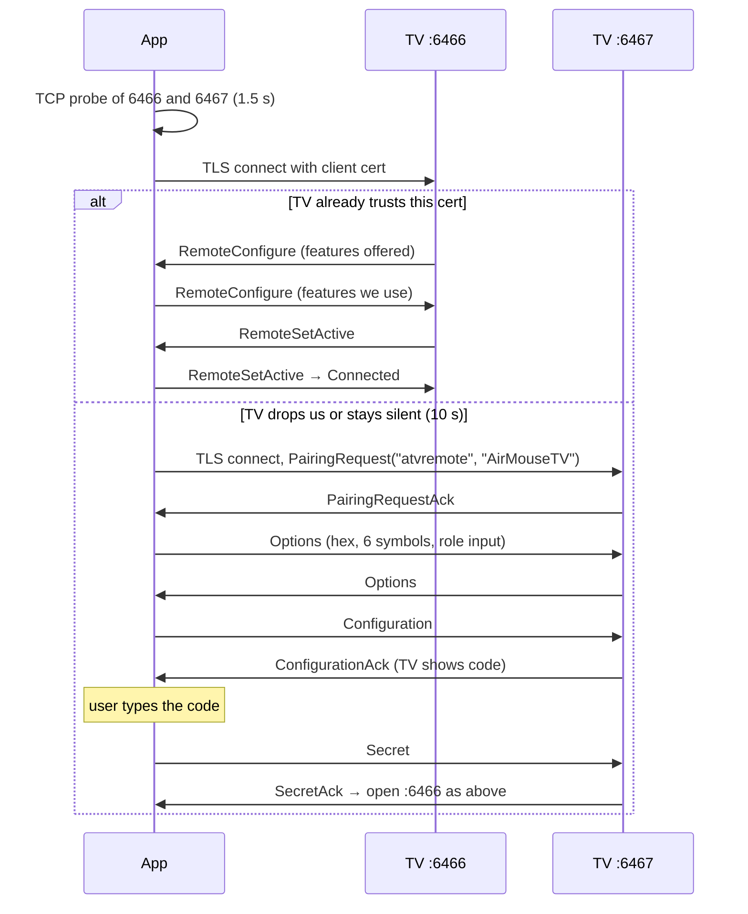

# Remote: design document

| | |
|---|---|
| **Covers** | The phone remote for Android TV / Google TV as built, up to release 1.3 |
| **Status** | Built and released. Section 11 (UI) waits on the design overhaul in progress |
| **Related** | [Air mouse design](air-mouse.md) (planned) · [CHANGELOG](../../CHANGELOG.md) |

This document says what the remote does, how it is built, and why. Most of the "why" comes from
how real TVs behaved while testing, so where a number or rule looks arbitrary, the reason is given
next to it. The code comments carry the same reasons in more detail.

---

## 1. Goals and non-goals

**Goals**

- Control any Android TV or Google TV from an Android phone over the local Wi-Fi, with **nothing
  installed on the TV**.
- Speak the same protocol as Google's own TV remote, so every TV that works with Google's remote
  works with this one.
- Pair once with the code shown on the TV, then reconnect silently.
- Be honest about the connection: the UI shows whether the TV is really reachable.
- Type into the TV's text fields from the phone keyboard.
- Stay small, private and local: no account, no cloud, no analytics.

**Non-goals (for this part of the app)**

- A pointer or mouse cursor on the TV. The stock protocol has no messages for it; see the
  [air mouse design](air-mouse.md).
- Voice input, for now. It is planned (section 16).
- TVs that aren't Android TV / Google TV (LG webOS, Samsung Tizen, Roku and so on).
- Controlling a TV from outside the local network.

## 2. System context

All traffic stays on the LAN. The TV side is the stock Android TV Remote Service: no companion app.

## 3. Architecture

### 3.1 Layers

Single Gradle module (`app`), Kotlin, Jetpack Compose, Hilt, protobuf-lite. Min SDK 24, target 36.

| Package | Role | Android-free? |
|---|---|---|
| `data/api/` | Protocol code: frame codec, protobuf encoders, pairing secret, key and text mappers, text-edit planning, IPv4 helpers, power-timing rules (`TvSilence`) | **Yes**, covered by plain JVM tests |
| `data/model/` | Plain state and value types: `ConnectionState`, `RemoteUiState`, `RemoteMode`, `DiscoveredTv`, `ImeField`, `TvKey`, `KeyAction` | Yes |
| `data/repository/` | Discovery (NSD, subnet scan, HTTP name lookup), TLS connector, the TV session, small preference stores | No |
| `presentation/` | `RemoteViewModel` (the whole UI flow) and `TextEntryController` | `TextEntryController` is tested through a fake |
| `ui/` | `MainActivity`, one file per screen, theme | No |

Keeping protocol code free of Android is deliberate: the parts most likely to break (framing, the
pairing hash, text-edit planning, timing rules) are tested on the JVM without a device.

### 3.2 Main components

- **`RemoteSessionManager`** (`@Singleton`) speaks the protocols. It runs Polo pairing, the
  remote session, pings, and the TV's text-field reports, and owns the `ConnectionState`.
- **`TvTlsConnector`** only opens TLS sockets that present the client certificate. It knows
  nothing about what is sent over them.
- **`RemoteRepository`** (`@Singleton`) is the data layer's entry point: discovery, the TV list,
  key sending and the text-edit pacing.
- **`RemoteViewModel`** turns all of this into one `RemoteUiState` and drives the flow:
  discovery → connect/pair → remote, plus reconnects.
- **`TextEntryController`** keeps the TV's text field in step with the phone's text box. It talks
  to the TV through the `TvTextPort` interface, so it can be tested with a fake.

The session, repository and stores are singletons so a connection survives configuration changes
(rotation on tablets, dark-mode switches and so on).

### 3.3 State and screens

- `RemoteMode` (`Discovery`, `Pairing(tv)`, `Connected(tv)`) chooses the screen. `MainActivity`
  just switches on `uiState.mode`.
- **No Navigation library and no back stack.** There are only three screens and they follow the
  connection state, so the screen is derived from state. Each screen handles Back itself (for
  example `BackHandler` on pairing calls `cancelPairing`).
- **Every way back to the TV list goes through `returnToDiscovery`**, so pairing and reconnect
  state are always cleared the same way.
- `ConnectionState.Error` carries a unique `id`, so the same error twice in a row (a wrong code
  entered twice) is still two emissions on a `StateFlow`.

## 4. Protocol

The app implements the Android TV Remote protocol v2, the one Google's remote apps use. The message
definitions are in `app/src/main/proto/polo.proto` and `remotemessage.proto`.

### 4.1 Transport and framing

- Both ports use **TLS with a client certificate**. The TV's certificate is self-signed, so there
  is no CA chain to check. It is pinned instead (section 7).
- Each message is a protobuf body preceded by its length as a **protobuf varint**
  (`FrameCodec`). Frames over **64 KiB** or length prefixes over 5 bytes are rejected: real
  messages are a few hundred bytes, so this only stops garbage or hostile input.
- Writes to one connection are serialised with a mutex so frames never interleave. Each
  connection has its own reader coroutine, and a late frame from a replaced connection is ignored.

### 4.2 Connecting: trust check first, then pairing

- `connect()` always tries the remote port first. A TV that doesn't trust the certificate closes
  the connection straight away, so the **10 s** wait (`TRUSTED_CHECK_TIMEOUT_MS`) only matters
  for a slow trusted TV, such as a stick waking from standby.
- `reconnect()` (used on launch and after a drop) **never falls back to pairing**. If the TV no
  longer trusts us, the user lands on the TV list and chooses to pair again.
- Pairing messages are only accepted in their expected phase (`Phase` enum). A wrong code
  (`STATUS_BAD_SECRET`) keeps the connection open so the user can try again. Other non-OK statuses
  end the attempt.
- The ViewModel gives the TV **15 s** (`PAIRING_RESPONSE_TIMEOUT_MS`) to show a code or accept us,
  so a spinner is never left running.

### 4.3 The pairing secret

`computePairingSecret` = SHA-256 over client modulus, client exponent, server modulus, server
exponent (unsigned big-endian bytes), then code characters 3–6 as three bytes. Hashing both public
keys binds the code to this exact pair of certificates.

The first byte of the hash must equal the first two characters of the code. That lets a typo be
rejected **on the phone** without a round trip, and the user can retype at once.

The code is six hex characters (0–9, A–F). `normalizePairingCode` upper-cases input and drops
anything else, and is the single place those rules live.

### 4.4 The remote session

- **Features.** The app asks for PING (1), KEY (2), IME (4), POWER (32), VOLUME (64) and APP_LINK
  (512), and uses only those the TV also offers. Voice isn't requested yet (planned, section 16).
- **Keys.** `RemoteKeyInject` with a direction: `SHORT` for a tap, `START_LONG` / `END_LONG` for
  a hold. `TvKeyMapper` maps the app's `TvKey` to Android key codes.
- **Text.** `RemoteImeBatchEdit` messages (section 9). The TV reports its focused field through
  `RemoteImeKeyInject` (focus change / foreground app), `RemoteImeShowRequest` (the field's text,
  also sent after each of our edits) and its own `RemoteImeBatchEdit` (`imeCounter` 1 when a text
  session opens, 0 when it closes).
- **Links.** `RemoteAppLinkLaunchRequest`, used for YouTube search (section 10).
- **Other TV messages** are logged into the diagnostics: volume reports, screen on/off
  (`RemoteStart`) and `RemoteError`.

## 5. Discovery

TVs are found in three ways, and all of them feed the same de-duplicated list
(`RemoteRepository.discoveredTvs`, matched by service name or address).

### 5.1 mDNS (NSD)

- Browses **`_androidtvremote2._tcp`** (advertised by the remote service itself, so it is there
  whenever the remote works) and **`_googlecast._tcp`**.
- A Wi-Fi **multicast lock** is held only while discovery runs, because receiving multicast costs
  battery.
- Resolving: on API 34+ one `ServiceInfoCallback` per service. Below 34, `NsdManager` can resolve
  only one service at a time, so resolves are queued.
- **Address choice** (`pickHost`): prefer IPv4, then any non-link-local IPv6. A link-local address
  alone is never listed, because the same TV shows up with IPv4 a moment later and would otherwise
  be listed twice.
- **Name**: TXT keys `fn`, `friendlyName`, `name`, `deviceName`, then the remote service name.
  If there's none, the HTTP lookup runs (5.3).
- **Lost service**: only losing the *remote* service removes a TV. The cast service can come and
  go while the remote still works. A lost remote service is matched to its TV by address, since
  the cast advert uses a different name.

### 5.2 Subnet scan and add by IP

Some networks (guest Wi-Fi, mesh systems, some routers) drop multicast, so mDNS sees nothing.

- **When it runs:** if discovery finds nothing within the **8 s** scan window, and on every manual
  refresh.
- **How:** a TCP connect to port **6466** on every host of the phone's network, **64 in
  parallel** with a **400 ms** timeout. A network wider than /24 is cut down to the /24 around the
  phone, so a sweep takes about 2 s.
- **Add by IP:** the user can type an IPv4 address. `parseIpv4` refuses loopback, multicast,
  broadcast and 0.x.x.x. The TV is listed as "TV at <address>" until the HTTP lookup finds its
  name.

### 5.3 HTTP name lookup

For TVs without a usable name, `TvPortScanner` sends `GET /` to ports 8008, 8009, 7675, 8060, 5353,
80 and 8080 in parallel. It takes `friendlyName` / `deviceName` / `name` from JSON, XML or headers.
The port that answered is cached per address.

### 5.4 Keeping the list true

- NSD doesn't reliably report a TV that was switched off. So while the list is showing, every
  listed TV is probed every **5 s** and removed after **2** misses in a row (one miss can be a
  dropped packet).
- Tapping a TV first runs a quick reachability probe (TCP to 6466 and 6467, **1.5 s**). A TV that
  doesn't answer is removed from the list with a message, instead of opening a pairing screen that
  would hang.
- Refresh clears the list and restarts NSD, so TVs switched off since the last scan drop out.
- If the saved TV turns up at a new address (a DHCP change), the saved address is updated.

**Names from the network are untrusted.** Any device on the Wi-Fi can choose them, so control
characters are stripped and names are capped at 64 characters (`cleanDeviceName`).

## 6. Keeping the session alive

### 6.1 Detecting a dead TV

A TV switched off abruptly never closes its socket, so a blocking read could wait for hours.

| Situation | Read timeout | Why |
|---|---|---|
| TV has pinged this session | **40 s** of silence | Most TVs ping every ~5 s, but a waipu tv stick went quiet for over 15 s |
| TV hasn't pinged yet | **90 s** | Some sticks stay silent while idle; cutting them off at 15 s made the session reconnect over and over |
| Pairing screen | Probe every 5 s, 2 misses | The pairing connection carries no pings, and the user may sit on the code screen for minutes |

### 6.2 Reconnecting

- On a drop, the remote stays on screen with its keys disabled and a banner saying it's
  reconnecting. There are **4** retries with delays of 1, 2, 4 and 8 s. After that the user is
  back on the TV list with a reason.
- On launch, the last TV is reconnected silently. If that fails, the user lands on the TV list.
  Launch never starts pairing on its own.
- Discovery waits for a network and starts by itself once Wi-Fi comes up (`NetworkMonitor`).
  Internet access is not required.

### 6.3 Power handling (release 1.3)

Real TVs showed a nasty failure: a Power press sent while the TV was going to sleep was **held by
the network stack and delivered when the TV next woke**, switching it straight back off. The
rules that prevent it are in `data/api/TvSilence.kt`:

- **Unsent data is discarded on close.** Sockets are closed with `SO_LINGER(0)`, so the phone
  doesn't keep resending old presses for minutes afterwards.
- **Awake check before sending.** If a TV that pings has been silent for over **8 s**, or Power
  was tapped and the TV hasn't been heard from for **15 s** since, a key press first checks that
  the TV is still reachable. If it isn't, the press is dropped and the connection closed. Presses
  made in the meantime wait for the answer.
- **Repeat guard.** A second Power tap within **4 s** is ignored.
- **TVs that can't be woken.** If the connection is lost within **180 s** of a Power tap and the
  TV is then unreachable, the TV leaves the network when off (usually one with an IR remote and no
  network standby). The app says so, remembers it per TV (`WakeSupportStore`), and warns on the
  next Power tap. If such a TV is later seen staying on the network after Power, the flag is
  cleared.

## 7. Security and privacy

- **Client identity.** A 2048-bit RSA self-signed certificate, valid 10 years, generated with
  BouncyCastle on first use and kept in the app-private file `atv_client.p12`. It must persist,
  since the TV only accepts the certificate it paired with.
- **Keystore password is fixed in code** (`"atv-remote"`). It only protects an app-private file
  and backup is off. Moving the key to Android Keystore would force every TV to re-pair, so it
  was left as is.
- **Trust on first use for the TV** (`CertPinStore`). The pairing port accepts any certificate,
  because the code proves the TV. The remote port's certificate is pinned per address (SHA-256 of
  the DER) the first time it is seen, right after pairing. A different certificate at that address
  is refused. Pairing again forgets the pin so a new certificate can be learned.
- **Backups off** (`allowBackup="false"`), so the key and pins never leave the device.
- **Logging.**
  - Release builds strip `Log.v/d/i` through R8, because those lines contain TV names and
    addresses. Warnings and errors stay.
  - Frame hex is only logged in debuggable builds, since it includes the pairing secret.
  - Diagnostics record a text field's *length*, never its contents, because a field may hold a
    password.
- **Permissions:** `INTERNET`, `ACCESS_WIFI_STATE`, `ACCESS_NETWORK_STATE`,
  `CHANGE_WIFI_MULTICAST_STATE`. No location, no runtime permissions.

## 8. Keys

- **Tap vs hold.** A key held past **400 ms** sends `START_LONG`, and `END_LONG` when the finger
  lifts. That way volume repeats and Power opens the TV's power menu. If the press is interrupted
  (the keys get disabled for a reconnect, or the screen goes away), the held key is still released, so the TV
  doesn't keep it down.
- **D-pad / touchpad.** The touchpad turns swipes into D-pad presses, one per **40 dp** dragged so
  a long swipe keeps scrolling, and a tap into OK. It is **not** a pointer. The choice is
  remembered.
- **Volume** has minus / mute / plus and no slider, because the protocol sends volume steps, not
  an absolute level.
- **Play/pause** uses one combined glyph, because the TV doesn't report playback state. A hint
  notes that some apps ignore media keys.
- All keys have TalkBack descriptions.

## 9. Text entry

This was the hardest part to get right, because TVs apply edits unreliably.

### 9.1 When the text box opens

- The phone's text dialog **opens by itself whenever the TV reports a newly focused text field**
  (`ImeField.showRequests` goes up), even if the TV's own on-screen keyboard isn't open. This is
  wanted.
- The keyboard button is dimmed while the TV has no text field. Tapping it then explains what to
  do.
- If the field is focused but has no open text session (for example SmartTube's search the first
  time), the dialog presses OK on the TV. That opens the TV's keyboard, and the text session
  follows.
- The dialog closes with a message when the TV's field goes away.

### 9.2 Two ways to send text

1. **Text session (IME feature).** Observed TV behaviour: a text edit *replaces the word at the
   cursor* (the text after the last whitespace), and a delete edit removes characters before the
   cursor. So `planTextEdit` diffs the old and new text, deletes what changed at the end, then
   sends the current last word plus the new characters ("why" → "why " → "why h" goes out as
   "why", "why ", "h"). When something was deleted *and* new text follows, the rest of the word is
   deleted too, because the TV sometimes inserts after the word instead of replacing it, doubling
   it.
2. **Key presses (no text session).** The difference is typed as key presses on a US layout
   (`TextKeyMapper`), with Shift for capitals and symbols, **30 ms** apart so slow TVs don't drop or
   reorder them. Characters with no key are skipped and reported to the user. Shift is always
   released, even if the send fails.

### 9.3 Following what the TV reports

- **Edit spacing.** The TV only replaces the word reliably when the previous edit was more than
  about **350 ms** earlier, so edits are spaced **450 ms** apart. Edits made while waiting are
  merged into the newest one. Swipe typing rewrites the word many times a second, and only the
  final text matters.
- **Correction loop.** After each edit, the controller waits up to **1 s** for the TV's report of
  its text. If it differs, the TV's text becomes the new baseline and the wanted text is sent
  again: at most **4** corrections in a row, and only while each one brings the TV closer
  (`mismatchSize`). That stops endless loops on a TV that rewrites text by itself.
- **Settle check.** TVs sometimes change the text a moment later. Once typing has paused for
  **1.5 s**, the controller compares again, but only if the same field is still focused and the
  TV has reported something new.
- **Giving up.** If the TV's text can't be brought in line, it is accepted as the truth and the
  phone's text box is updated to show it.
- Edits in the middle of long text resend the tail. This can be revisited if it causes problems in
  real use.

## 10. YouTube search

YouTube on TV draws its own keyboard, which can't be typed into from the protocol. When the TV
reports YouTube in front (`com.google.android.youtube.tv*`), a **YouTube search** button appears.
It opens `vnd.youtube://results?search_query=…` through an app link, with spaces encoded as `%20`
because YouTube shows `+` literally.

An `intent://` link naming the package would skip the "Open with" chooser on TVs with two YouTube
apps, but the TV answers it with a `RemoteError` and closes the connection. So the plain link is
used.

## 11. UI and design system

> **Pending the design overhaul.** This section describes the shipped 1.3 UI. It will be updated
> when the overhaul now in progress is finalised.

- **Screens:** Discovery (TV list, scan indicator, refresh, add by IP), Pairing (spinner, then six
  code boxes), Remote (header with TV name and ⋮ menu, media pill, D-pad/touchpad toggle, pad,
  Back / Home / Keyboard / YouTube search, volume bar).
- **Theme:** "Deep Code", taken from a Google Stitch design. Dark only: teal (`#00C4CC`) on
  charcoal (`#161A1F`), Space Grotesk font bundled, 8 dp corners on most controls (shapes come from the theme). Control borders (`#626A75`) are
  3.2:1 against the background, above the 3:1 accessibility guideline. Green / red mark
  online / offline and amber marks warnings, all kept distinct from teal, which means selection.
- **System widgets over custom UI.** The pairing code uses the system keyboard through
  `KeyboardOptions` (number row plus capitals), not a custom keypad.
- **Fits without scrolling.** The pad takes the height left over. Below **620 dp** of usable height
  (scaled by font size) the page scrolls and the pad keeps a fixed 240 dp, so it never shrinks to
  nothing.
- **Orientation:** phones are locked to portrait. Tablets and foldables (sw ≥ 600 dp) can rotate.
- Edge-to-edge with transparent system bars, and a dark window at start-up (no white flash).
- Composables are private to their screen file unless shared, and every screen has `@Preview`s
  for its main states.

## 12. Diagnostics

Users without adb can copy **diagnostics** from the remote's ⋮ menu. They contain the last 60
events: handshake steps, the TV's vendor, model and offered features, text-session events (lengths
only), volume reports, screen on/off, scan results and connection losses. This is how problems on
TVs we don't own (such as missing text input) get diagnosed.

## 13. Build, test and release

- **JDK 17** is required. JDK 24 breaks the Android Gradle plugin.
- **Unit tests:** `./gradlew :app:testDebugUnitTest`. They cover the frame codec, protobuf wire
  format, pairing secret and code rules, key and text mappers, text-edit planning, the text entry
  controller (with a fake TV), power-timing rules, IPv4 parsing and scan ranges, certificate
  pinning, client certificate persistence, name parsing, address choice, and `DiscoveredTv` /
  `ImeField` helpers.
- **Release:** `./gradlew :app:assembleRelease`, with R8 minify and resource shrinking (about
  14 MB → 1.5 MB). Protobuf-lite looks fields up by name, so `proguard-rules.pro` keeps the
  generated message fields. Without that rule the protocol fails at runtime with
  `NoSuchFieldException`.
- **Smoke test every release build on a real phone and TV.** R8 problems only show at runtime.
  Check discovery, a fresh pairing, a key tap, a long press and typing through the text session,
  then look in logcat for `NoSuchField` / `ClassNotFound`. Repeat whenever dependencies or the R8
  rules change.
- **Versioning:** `CHANGELOG.md` and `versionName` / `versionCode` in `app/build.gradle.kts`
  change together. Git tags match versions (1.0–1.3).

## 14. Decision log

Ordered by the release each decision shipped in, oldest first.

| Since | Decision | Why |
|---|---|---|
| 1.0 | Use the stock Android TV Remote v2 protocol | Works with every Android/Google TV, nothing to install on the TV |
| 1.0 | Phased plan: stock remote first, air mouse later as an optional mode | Air mouse needs a TV companion app; see [air-mouse.md](air-mouse.md) |
| 1.0 | One ViewModel, screens derived from state, no Navigation library | Three screens that follow the connection state; no back stack to manage |
| 1.0 | Try the remote port before pairing | A trusted TV connects with no user action |
| 1.0 | Reconnect never falls back to pairing | Pairing needs the user at the TV; never start it unasked |
| 1.0 | Fixed keystore password | Protects only an app-private file; moving keys would force re-pairing everywhere |
| 1.0 | Read timeouts of 40 s (pinging) / 90 s (not yet pinged) | Quiet sticks were dropped repeatedly at 15 s |
| 1.0 | Edits spaced ≥ 450 ms | Measured: edits under ~350 ms apart are applied unpredictably |
| 1.0 | Text dialog opens whenever the TV focuses a field | Wanted behaviour, even without the TV keyboard open |
| 1.0 | Dark-only theme from the Stitch "Deep Code" design | Single consistent look; the UI overhaul may revise it |
| 1.1 | YouTube search through a plain `vnd.youtube://` link | YouTube's keyboard can't be typed into, and `intent://` makes the TV close the connection |
| 1.1 | Portrait lock on phones only | A remote isn't meant to rotate; Android 16 ignores the lock on large screens anyway |
| 1.2 | Protocol code free of Android | JVM unit tests for the riskiest logic |
| 1.2 | Trust on first use for the TV certificate | Self-signed TV certs have no CA; the code proves the TV at pairing |
| 1.2 | Strip `Log.v/d/i` in release | Those lines carry TV names and addresses |
| 1.2 | Text entry follows the TV's reported text, with a correction cap | TVs apply edits unreliably |
| 1.2 | System keyboard for the pairing code | Prefer system widgets over custom UI |
| 1.3 | Session manager speaks protocols; TLS connector only opens sockets | Keeps the protocol logic separate from certificate handling, and each can be tested alone |
| 1.3 | Subnet scan and add by IP | Some networks drop multicast |
| 1.3 | Discard unsent data on close; awake check; 4 s Power guard | Stale Power presses switched TVs back off when they woke |

## 15. Known limitations

- No pointer or mouse. The touchpad sends D-pad steps only.
- No voice input yet (planned, section 16).
- TVs that leave the network when off can't be turned on from the app (a protocol and hardware
  limit). The app detects and explains this.
- Some apps ignore media keys, and some text fields never open a text session. Key-press typing
  then covers US-layout characters only.
- Discovery depends on mDNS or a /24 scan. Larger or segmented networks may need add by IP.
- Text edits in the middle of long text resend the tail.

## 16. Future work

Planned features for the remote. Each gets its own design section here before it is built. The air
mouse has its own document ([air-mouse.md](air-mouse.md)).

### 16.1 Voice search

Hold a mic button on the phone and speak, and the TV runs a voice search, like the mic button on
the TV's own remote.

- **Protocol:** `remotemessage.proto` already reserves `RemoteVoiceBegin`, `RemoteVoicePayload` and
  `RemoteVoiceEnd` (fields 30–32 of `RemoteMessage`), but their fields aren't defined yet. They
  have to be filled in, and the voice feature added to the bitmask the app asks for.
- **App:** needs the `RECORD_AUDIO` runtime permission (the app's first runtime permission). Audio
  is streamed to the TV only while the button is held.
- **Open questions:**
  - Which audio format and chunk size the TV expects.
  - Which TVs offer the voice feature. The diagnostics already log the features each TV offers,
    so this can be gathered from users.
  - A fallback for TVs without it, such as phone speech-to-text typed into the search field
    through the text session.
  - How the permission and the "listening" state are shown to the user.

### 16.2 Favourite apps

Open apps such as Netflix, YouTube or Prime Video directly from the remote, without going through
the TV's home screen.

- **Protocol:** uses the app-link feature already in use for YouTube search
  (`RemoteAppLinkLaunchRequest`).
- **Constraints we already know:**
  - The TV doesn't report which apps are installed. It only reports the app currently on screen
    (its package name, such as `com.netflix.ninja`), each time that app changes. So favourites
    come from a built-in list of common apps, or from apps the user has had on screen and chose to
    pin.
  - `intent://` links make the TV close the connection (section 10). Launch links must be plain
    URLs or app schemes, worked out per app and tested on real TVs.
- **Why not the manifest:** `<queries>` in the manifest only grants visibility of apps installed
  on the *phone* (through the phone's `PackageManager`). The TV is a separate device, and the
  protocol has no way to ask it what's installed.
- **Proposed approach:**
  1. **Built-in catalogue.** The app ships a small list of common TV apps (a Kotlin or JSON file,
     not the manifest). Each entry has a display name, an icon, the TV package name (for example
     `com.netflix.ninja`) and the launch link.
  2. **Confirm by launching.** When a favourite is tapped, the app sends its link and watches the
     app the TV reports on screen. If the expected package appears within a few seconds, the app
     is installed on that TV, and that is remembered. If not, the phone shows "Not on this TV" and
     dims the favourite for that TV.
  3. **Learn from use.** When the TV reports an app on screen that isn't in the catalogue, the
     user can pin it as a favourite. This covers apps the catalogue doesn't know.
  4. **Per TV.** What's installed and what's pinned are stored per TV, since each TV has
     different apps.
- **Must be tested on real TVs before building:** what the TV does with a link for an app it
  doesn't have. It may open the Play Store, show a chooser, or answer with a `RemoteError`, which
  for `intent://` links also closes the connection. That decides whether step 2 is safe as it is,
  or needs a reconnect path.
- **Open questions:**
  - Where favourites appear in the UI (this depends on the design overhaul).
  - How long to wait for the TV to report the app before treating it as not installed.
  - How to keep the catalogue's links current as apps change them.
